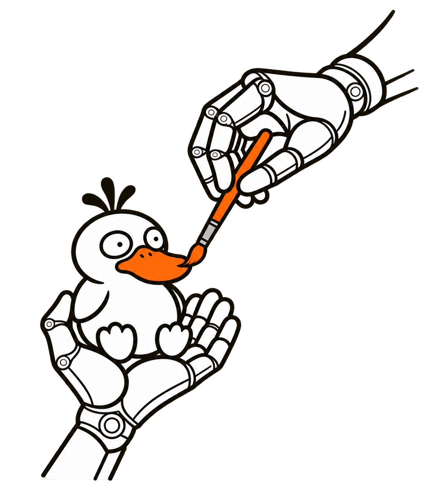

# On Psyduck

### 论·可达鸭

*Two hands, a paintbrush, and a few questions from CoRL 2026*  
*Runfa Blark Li 李润发 · November 17, 2026*

**Full workshop recording:** [YouTube](https://youtu.be/HNI-dcrl54I) · [Bilibili](https://www.bilibili.com/video/BV1EVsu6QE5n/)

On November 12, I helped organize and hosted the BiDexTool workshop at CoRL in Austin. I started with our logo: one robotic hand holding a Psyduck figurine, the other painting it with a brush.

I made the image with ChatGPT. Then I asked the room to imagine doing it with a real robot, a real figurine, and a real brush.

That is where the questions begin.

One hand needs to hold Psyduck without dropping it. It also needs to turn the figurine so the brush can reach the next surface. The other hand needs to move the brush at the right angle and press with the right amount of force. As the figurine turns, the brush has to adjust.

This was a convenient way to introduce the three words in our workshop's name: bimanual, dexterous, and tool use. Two hands coordinate. Fingers adjust the grip. A tool lets the robot do something to the object. [\[1\]](#ref-1)

Now suppose we get all of that working. We hand the robot a softer brush.

How much of what it learned is still useful?

That question connects much of what we discussed during the workshop. Below are a few thoughts from the talks and panel, organized around the questions I am still thinking about.

## What counts as a useful skill?

I started the panel by asking Jitendra Malik what would convince him that a robot had learned a general ability to use tools with both hands. He emphasized robustness, generalization, and speed. [\[2\]](#ref-2)

These are related, but they ask different things. Does the robot succeed repeatedly? Does it still succeed when we change the tool or the task? And how long does it take?

The last question is easy to overlook. If a robot completes a task but takes ten times longer than a person, that matters to anyone considering using it. Reporting success rates without execution time leaves out an important part of the result.

The discussion then raised a question I particularly liked: how much practice does the robot need for the next object? [\[2\]](#ref-2)

We often test whether a trained robot can immediately handle something new. That is useful. But we could also let it practice, then measure how quickly it improves. A robot that needs a few attempts with a new tool has learned something different from one that needs another week of training.

For our painting example, I would want to know whether the softer brush works on the first attempt. If it doesn't, how much practice does the robot need? Does experience with the first brush make learning the second one easier?

An audience member brought up a familiar experience: being good at something with the right hand, then finding it surprisingly difficult with the left. The discussion turned to the difference between knowing how a task works and having the motor skill to perform it. [\[3\]](#ref-3)

That distinction is useful for robots too. The steps for painting a figurine could stay the same when we change the robot's hand. The finger movements and forces may need to change considerably.

So when we say a skill transfers, we should explain what transferred and what still had to be learned. I would count faster learning on the new hand as progress too, provided we measure how much faster.

## What should a planner tell a controller?

This brings me to the part of the workshop I found especially interesting: what information should pass from a planner to a controller?

A planner decides what should happen next. A controller takes that request, observes what the robot is doing, and produces the movements needed to carry it out. Those descriptions sound straightforward. The difficult part is deciding how much detail belongs in the request.

In her talk, Karen Liu argued for object-centric plans. For example, specify where an object should move and how it should turn. Let a learned controller, often called a policy, work out the arm and finger movements needed to make that happen. [\[4\]](#ref-4)

Jitendra described a planner that calls learned skills, such as picking or inserting. The planner asks for a skill, and the policy handles its physical execution. In the discussion after his talk, he also considered language and visual examples as ways of communicating the request. [\[5\]](#ref-5)

To see the difference, imagine giving our painting robot one of three instructions. We could tell it which patch to paint. We could give it a path for the brush tip. Or we could specify a sequence of wrist and finger poses.

Each instruction leaves different decisions to the controller. A path for the brush tip still leaves room to choose how to hold the brush. A sequence of finger poses makes more of that choice in advance. An instruction to paint a patch leaves the controller to decide on the strokes as well.

This is why I don't think saying “we use a hierarchy” tells us very much on its own. We still need to explain what each part is responsible for.

During the panel, I brought up Nima Fazeli's idea of a “SONIC for contact,” which he had mentioned earlier in the week. In the motion-tracking setup we were discussing, a controller follows a supplied sequence of poses. I asked what the equivalent might be for manipulation involving contact.

Nima's answer emphasized the appeal of a reusable dexterous policy. The discussion then turned to a challenge: do we need to give that policy a reference trajectory at all? Could we give it a goal or a skill instruction and let it choose the motion? [\[6\]](#ref-6)

I think both questions deserve attention. We want a controller that can be reused across tasks. We also need to decide what it should be asked to follow.

For painting, a path alone may not specify how hard the brush should press. A force target alone does not say where to paint. And if the brush bends differently from what we expected, the robot needs to adjust while it works.

A reference does not have to stay fixed throughout execution. The planner could observe a missed patch and change the next stroke. Meanwhile, the controller could adjust its movements to keep the brush in contact. Both parts would be responding to what actually happened.

But that still leaves the design question: should the planner send a new path, an object target, a desired contact, or something else?

The workshop gave us several possibilities. It also gave us reasons to test them carefully. I would want to know which instructions a controller can follow reliably, and how much new training it needs when we change the task.

## What do we need to sense and simulate?

A controller can only respond to a problem if it has enough information to notice it.

In our painting example, the fingers touch the handle, while the bristles touch the figurine. The robot might be holding the brush securely and still be pressing too hard, missing the surface, or making the wrong stroke.

I asked Nima about this separation between the hand and the tool tip. His response covered tactile sensing, simulation, and the mechanics of the hand itself.

One question was how much detail a tactile sensor needs to capture for a particular task. More detailed sensing can add hardware complexity. It would be useful to test which differences in sensing actually change what the robot can do.

Another issue was the mechanism between the motor and the fingers. Friction and looseness in that mechanism can affect the hand's response. A simulator that misses those effects may teach a policy to expect movements the real hand does not produce. [\[7\]](#ref-7)

The discussion of slip made the connection to control more concrete. Suppose the brush begins to move inside the fingers. The robot might need to tighten its grip, reposition the brush, or stop the stroke. The useful response depends on the task and on how much time remains before the brush slips out. [\[8\]](#ref-8)

So I would start with the decision we want the robot to make. Then I would ask what it needs to observe to make that decision in time.

Simulation also has to give the robot useful opportunities to learn. Ankur Handa pointed to interactions that remain difficult to simulate accurately, such as insertion with very small clearances. He also raised the problem of exploration: even in a good simulator, the robot may struggle to discover movements that make progress. Human demonstrations or other prior experience can help it get started.

When I asked what he would improve in simulators, Ankur emphasized accuracy. That led to a discussion of using more compute to maintain large-scale training while improving the physics. [\[9\]](#ref-9)

I would like to see those improvements judged by what happens on the real robot. Does a more accurate model of the hand reduce failures? Does a better contact model help with a new tool? How much real-world practice is still needed?

Those questions connect simulator development to the behavior we want to improve.

## Where should we invest: hardware, learning, or both?

I asked the panel to imagine having one year and a fixed budget to make a robot use unfamiliar tools reliably. What would they invest in first? [\[10\]](#ref-10)

Alex Xia chose hardware, particularly reliability and consistency. His earlier talk had described problems with transmission wear, heat, and force control. [\[11\]](#ref-11) These are practical concerns for anyone who wants a hand to keep working over many experiments.

Other answers put more weight on pretraining and compute. There was also a case for improving hardware and learning together. [\[10\]](#ref-10)

The disagreement makes sense to me. If the hand behaves differently from one run to the next, improving its consistency could make both training and execution easier. If a policy can learn to handle that variation, investing in learning might achieve more with the hardware we already have.

We can test how far that second argument goes. Take a policy that works on one hand and give it another. How much does performance drop? How much additional experience does it need to recover? Repeat after the mechanics have changed through wear.

In the closing round, Alex described evidence that would change his view: a model working well with unfamiliar or less reliable hardware, with little or no additional training. [\[12\]](#ref-12)

The audience also asked a related question: with simple grippers already doing impressive things, what makes dexterous hands worth the added complexity?

The discussion brought up using a tool while operating its trigger, holding more than one object, and changing an object's position inside the hand. These examples helped explain where additional fingers could be useful. [\[13\]](#ref-13) The value depends on what we want the robot to do.

For the painting task, we could hold the figurine in a fixture and use a simple gripper for the brush. Giving the robot another hand lets it reposition the figurine itself. Fingers give it more ways to change its grip. Those options may help, but they also make the system harder to build and train.

I think a convincing demonstration should show what the extra capability buys us.

## What experiments would change our minds?

We ended the panel by asking what experiment people wanted the community to run next.

One proposal was to train policies in several simulators and compare their performance on real hardware. That would help identify which differences between simulators matter in practice. To interpret the results, I would also want to know how much compute and tuning each setup received.

Another proposal was to evaluate AI agents across a range of robotic skills, with numbers for generality, speed, and accuracy. An agent might make it much easier to write training code or assemble an existing system. We should then measure how well the resulting robot performs.

There were also calls to measure adaptation more carefully and to report how often a system successfully completes useful work. [\[12\]](#ref-12)

My own version of these experiments would return to Psyduck.

Start with a robot that can paint the figurine. Give it a softer brush and measure the quality and speed of its first attempt. Let it practice, and record how much experience it needs to improve. Then swap Psyduck for Pikachu. Later, try a different hand.

After each change, test the earlier setup again. We would want to know whether learning something new damaged a skill the robot already had.

This is an experiment I am proposing here, inspired by the discussion. It would give us a concrete way to compare the choices we debated: instructions, feedback, training methods, simulation, and hardware.

I would be happy to see a robot paint one Psyduck well. I would learn much more from watching what happens when we change its brush.

---

Thank you to our speakers and panelists—Alex Xia, Karen Liu, Jitendra Malik, Ankur Handa, and Nima Fazeli—and to our authors, reviewers, volunteers, and everyone who joined the discussion. Thank you to Xynova, Origami Robotics, and SOMA Robotics for supporting the workshop.

I organized the workshop with Yunhai Han, Haonan Chen, Jiaheng Hu, Yuxiang Ma, Nicklas Hansen, Toru Lin, Weizhe Ni, Xianyi Cheng, Jiajun Wu, Nima Fazeli, and Nikolay Atanasov.

Congratulations to our best paper award winners: **T-Rex** (first prize), **SimDuoReal** (second prize), and **FACT** (third prize). [\[14\]](#ref-14) The [workshop website](https://bimanual-tool.github.io/) has the program, papers, and award details.

## One question for later

While preparing the workshop, I kept wondering whether someone would ask why I, personally, was so set on putting bimanual manipulation, dexterous hands, and tool use together.

There are good research reasons, and I've spent most of this post discussing them. I also have a more personal reason that I'm not ready to share yet.

There is also the small matter of whose idea of a well-painted Psyduck we are aiming for.

Had someone asked me that version of the question, my answer would probably have been:

“Ask me again in three years. I'd like to show you why.”

So I'm leaving this paragraph here, with a date on it. If things go well, I'd like to come back and explain.

*(The only part of this post with absolutely no AI editing. Yes, this one matters.)*

For now, Psyduck is keeping quiet.

## References and timestamps

Times are positions in the full workshop recording, written as hours:minutes:seconds. Watch on [YouTube](https://youtu.be/HNI-dcrl54I) or [Bilibili](https://www.bilibili.com/video/BV1EVsu6QE5n/).

**[1] Opening example.** 00:00:00–00:05:31.

**[2] Robustness, generalization, speed, and practice with a new object.** 02:49:04–02:53:28.

**[3] Right/left hand transfer and adaptation.** 03:15:54–03:21:40.

**[4] Karen Liu: object-centric plans and alternative interfaces.** 00:35:28–00:40:49; 00:58:21–01:02:50.

**[5] Jitendra Malik: skills, feedback, language, and visual instructions.** 02:12:25–02:17:27; 02:19:28–02:21:22.

**[6] SONIC for contact and controller interfaces.** 03:03:57–03:07:45.

**[7] Nima Fazeli: sensing resolution and transmission modeling.** 03:00:57–03:03:49.

**[8] Slip and the robot's response.** 03:13:05–03:15:13.

**[9] Simulation accuracy and exploration.** 02:57:14–03:00:45.

**[10] Where to invest: hardware, pretraining, and compute.** 03:07:51–03:12:34.

**[11] Alex Xia: hardware challenges and transmission wear.** 00:11:53–00:14:45.

**[12] Proposed experiments and evidence that could change views.** 03:29:04–03:34:00.

**[13] Why dexterous hands: tool operation and in-hand manipulation.** 03:22:04–03:28:56.

**[14] Best paper awards.** 03:34:40–03:36:07.

---

*Editing assistance: GPT-6 Astra.*
